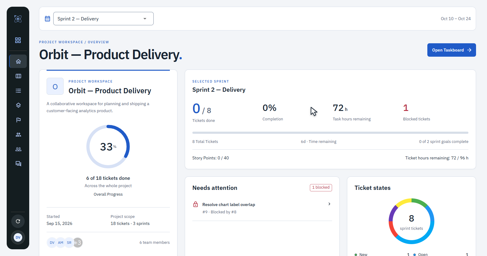
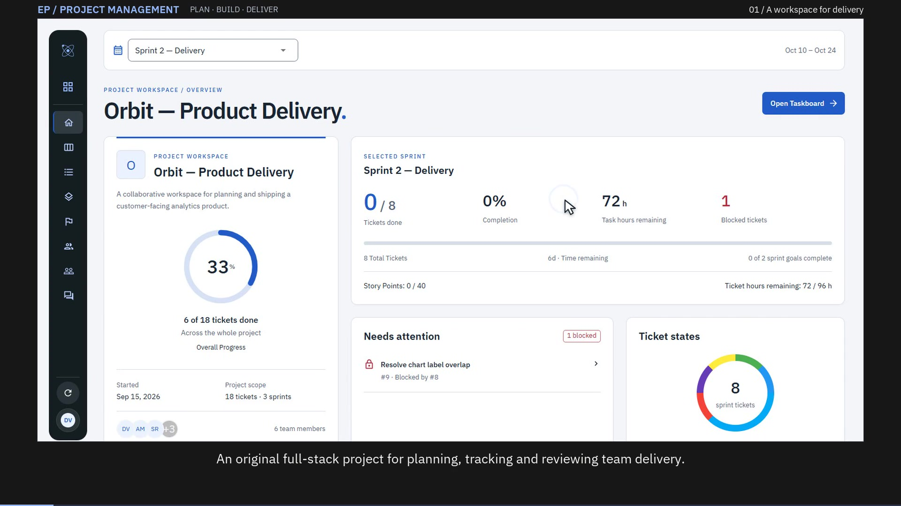
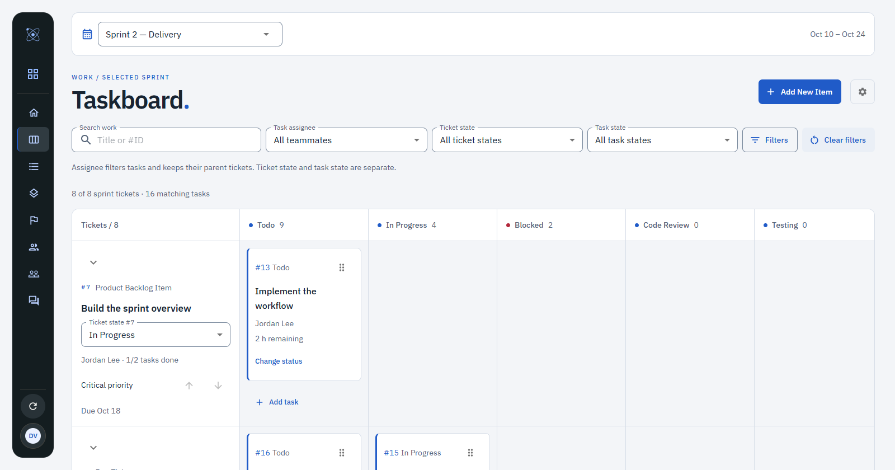
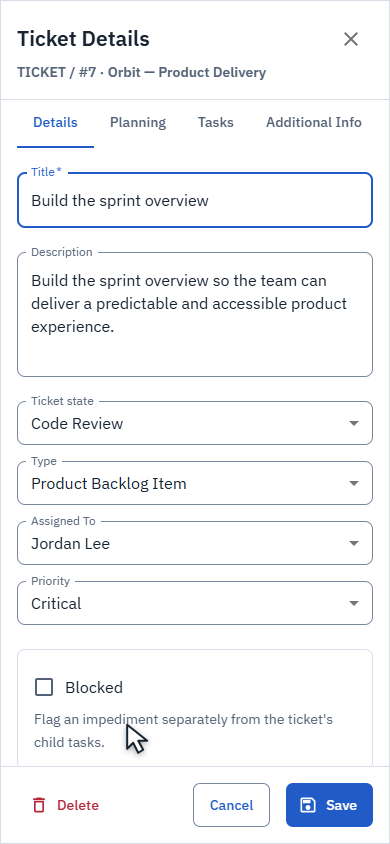
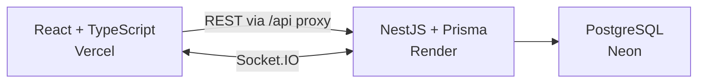

# EPProject Management

A full-stack workspace for planning sprints, following delivery and learning from the work.

I built this personal project from scratch, implementing the React interface, NestJS API, PostgreSQL domain model and real-time synchronization. The initial visual inspiration came from an interface image; the application and its connected workflows are my own implementation.

[Explore the live demo](https://project-management-murex-pi.vercel.app) · [Watch the walkthrough](https://project-management-murex-pi.vercel.app/walkthrough) · [Transcript and chapters](docs/walkthrough.md) · [Run locally](docs/development.md)



## Follow one connected workflow

1. Choose **Explore demo**, open **Orbit — Product Delivery** and select a sprint.
2. Trace an epic through its features and linked tickets, then inspect the selected sprint in **Backlog**.
3. Open a ticket to review its requirements, assignment, estimates, deadline and child tasks.
4. Use **Taskboard** to update ticket state and move tasks through their own execution states, by dragging or using the task editor.
5. Open another browser session: confirmed updates appear through **Socket.IO without a refresh**.
6. Plan available hours in **Capacity**, track **Goals** and checklists, then gather feedback in the sprint **Retrospective**.

The Taskboard keeps **tickets in rows and task states in columns**. A ticket's state is independent of its tasks. Project progress covers the whole project; sprint metrics follow the selected sprint. Mobile adapts these workflows into compact lists and contextual editors.

## Watch the product in motion

[](https://project-management-murex-pi.vercel.app/walkthrough)

The walkthrough follows real local application interactions, including two independent browser sessions receiving backend-confirmed updates. It includes English text in the picture, a genuine mobile viewport and both appearances. The public viewing page provides native playback, chapters, a readable transcript and downloads without joining the demo.

[Download MP4](https://project-management-murex-pi.vercel.app/walkthrough/project-management-walkthrough.mp4) · [English captions](frontend/public/walkthrough/project-management-walkthrough.vtt)

| Sprint execution | A ticket on mobile |
| --- | --- |
|  |  |

## What works

- Project creation, search, grid/list views, favorites and confirmed deletion.
- Project-wide epics, features, linked tickets and team membership.
- Selected-sprint Backlog with configurable columns and ticket-level search/filters.
- Ticket and task editors with validation, estimates, assignment, planning links, protected drafts and recoverable save failures.
- Taskboard drag-and-drop, an accessible task-state editing alternative and canonical updates shared between views and sessions.
- Sprint goals and checklists, member capacity and retrospective cards/reactions.
- Real project/sprint completion, workload, blockers, deadlines and latest-known updates.
- Responsive navigation and editing, Light/Dark appearances, keyboard workflows and reduced-motion support.
- Demo sessions with JWT access, cookie-backed renewal and explicit recovery when session/network operations fail.

## Engineering

**React 18 · TypeScript · Vite · Material UI · React Router · React Hook Form/Yup · Recharts · dnd-kit**

**NestJS 11 · Prisma · PostgreSQL · REST · Socket.IO**

The frontend and modular backend remain separate deployments. Vercel serves the application and proxies REST requests through `/api`; the browser's WebSocket connection goes to Render. Prisma owns database access to Neon PostgreSQL.



The workspace coordinates the selected sprint and canonical ticket collection. Backend-confirmed mutations feed both the acting session and independent observers; a ticket update does not replace newer task data with an older snapshot. Editors retain failed drafts and await confirmed saves/deletions. Scope checks and request validation protect relationships between projects, sprints, statuses and work items.

Tests exercise public browser, HTTP and WebSocket behavior with isolated PostgreSQL fixtures. Production environments are never used as disposable test databases. See the [verification record](docs/verification.md), [deployment decision](docs/adr/0001-despliegue-separado-para-portfolio.md) and [Taskboard decision](docs/adr/0002-taskboard-por-ticket-y-presentacion-adaptada.md).

```text
frontend/       React application and browser/component tests
backend/        Modular NestJS API, Prisma schema/migrations and HTTP tests
docs/           Local setup, deployment, decisions and presentation
```

## Run locally

Use **Node.js 22.x**, npm and a dedicated PostgreSQL database. No Vercel, Render or Neon account is required for local development.

```sh
git clone https://github.com/EPraz/projectManagement.git
cd projectManagement/backend
npm ci
```

Copy `backend/.env.example` to `backend/.env` and set `DATABASE_URL` to your new local database, `JWT_SECRET` to a random value of at least 32 characters, and `CLIENT_URL` to the frontend origin. From `backend`:

```sh
npm run prisma:generate
npm run db:deploy
npm run demo:seed
npm run start:dev
```

In a second terminal, from `frontend`, copy `.env.example` to `.env`, then run:

```sh
npm ci
npm run dev
```

Open the printed frontend address and choose **Explore demo**. The defaults are API `3000` and frontend `5173`; if changing ports, align the frontend proxy/socket origins and backend `CLIENT_URL`. `DATABASE_URL` is the only database connection variable.

The [development guide](docs/development.md) explains configuration, clean installation, tests and port conflicts. The [deployment guide](docs/deployment.md) covers the existing Vercel/Render/Neon setup and explicit manual demo restoration.

## Demo boundaries

- The live application uses one **shared, editable demo identity**. Visitors can see each other's changes; use fictional information. Personal registration/login and enforced role-based account permissions are outside this demo.
- Render's free backend may take about a minute to wake after inactivity. The walkthrough page and its static video can be viewed independently of the backend.
- Public visitor edits survive deployments. There is no scheduled reset or keepalive; demo restoration is an explicit maintenance operation.
- **Recent updates** summarizes known creation/latest-modification timestamps; it is not a complete audit history. The responsive web application does not claim native Android/iOS delivery.
- Local rehearsal and recording use a separate populated database. Their staged changes do not overwrite public visitor data.

IBM Plex Sans is bundled locally under its [font license](frontend/public/fonts/OFL.txt). Verification is scoped evidence, not a security or accessibility certification.
