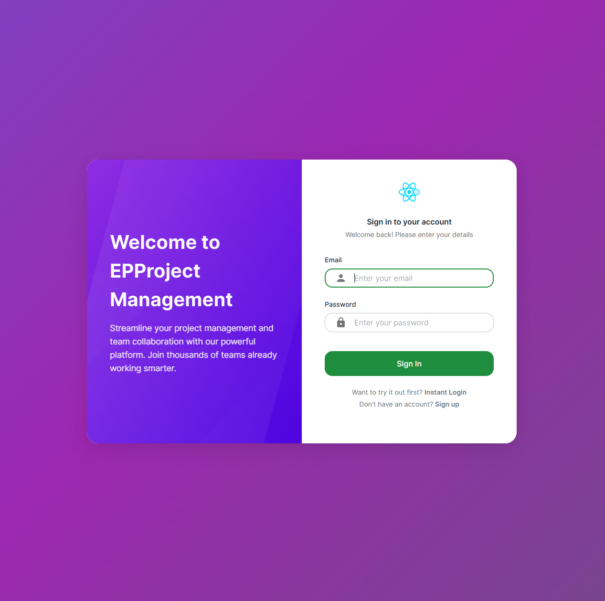
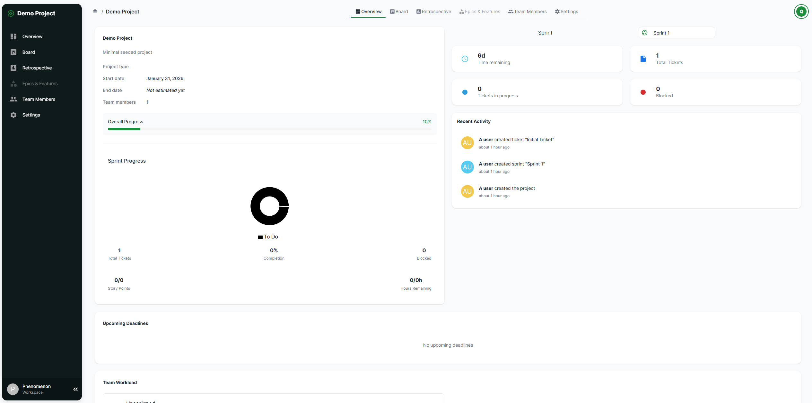

# Project Management App — Full-Stack Agile Platform

Production-ready project management platform inspired by Azure DevOps.
Designed to manage projects, teams, sprints, epics, features, tickets, and retrospectives with real-time collaboration and analytics.

Built with a modular NestJS backend and a React frontend. Prepared for separate deployments on **Render** and **Vercel**, with **Neon PostgreSQL**. See the [deployment guide](docs/deployment.md).

---

## ✨ Key Features

- Role-based access control (Admin, PM, Developer, QA, etc.)
- Project & team management
- Sprint planning and sprint goals
- Epics → Features → Tickets hierarchy
- Drag-and-drop taskboard
- Retrospectives (positive / negative / improvements)
- Real-time updates via WebSockets
- Progress tracking & charts
- Dedicated demo access with JWT sessions
- Responsive UI for desktop-first workflows

---

## 🧱 Tech Stack

### Frontend

- React
- TypeScript
- Vite
- React Router
- Charts.js

### Backend

- NestJS
- Prisma ORM
- PostgreSQL
- WebSockets (Socket.IO)
- REST API

### Infrastructure

- Vercel (React/Vite frontend and API proxy)
- Render (NestJS API and WebSockets)
- Neon (PostgreSQL)

---

## 🗂 Project Structure

├─ backend/ # NestJS API
├─ frontend/ # React + Vite SPA
├─ render.yaml # Backend deployment reference
└─ docs/deployment.md # Manual deployment, initialization and restoration

## Instructions to run local

### Backend

```bash
cd backend
npm install
# Initialize a NEW dedicated local database first; see docs/deployment.md.
npm run start:dev
# Servido en: http://localhost:3000/
```

### Frontend

```bash
cd frontend
npm install
npm run dev
# Servido en: http://localhost:5173/
```

Requires Node 22 and a dedicated PostgreSQL database. Copy each application's .env.example to .env and configure DATABASE_URL, JWT_SECRET and CLIENT_URL. This is a shared editable demo without personal account registration.

---

### 5. Main Routes & Navigation

```bash

- `/auth/instantLogin` → Explore demo (no email or password)
- `/projects` → Projects overview
- `/projects/:id` → Project dashboard
- `/projects/:id/board` → Taskboard, backlog, planning & goals
- `/projects/:id/retrospective` → Sprint retrospective
- `/projects/:id/epics` → Sprint retrospective
```

## Production

- [Manual deployment instructions](docs/deployment.md)
- [Repo on Github](https://github.com/EPraz/projectManagement)

## Notes

```bash
This project was built to demonstrate:
- real-world full-stack architecture
- scalable domain modeling
- production deployment workflows
- clean separation between UI, API, and data layers
- Future improvements may include permissions granularity, notifications, and advanced analytics.
```

## 📸 Preview

<p align="center">
    &nbsp;&nbsp;&nbsp;
</p>
<p align="center">
    &nbsp;&nbsp;&nbsp;
</p>
